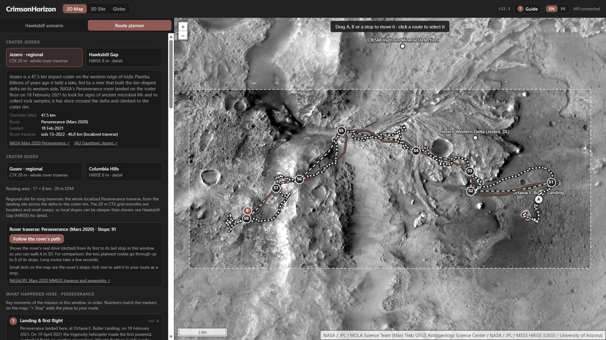
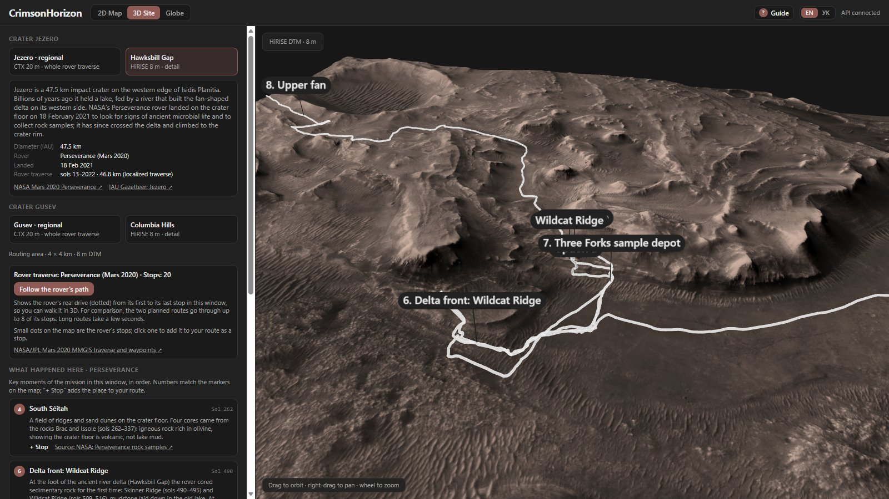
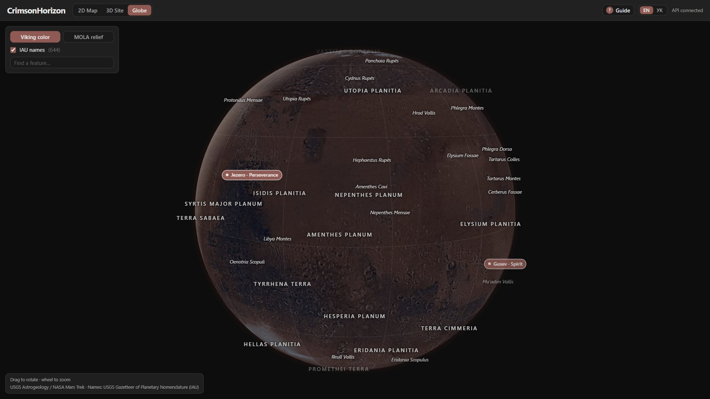
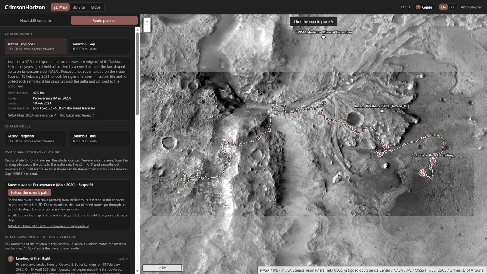

# CrimsonHorizon

A web app for planning astronaut walks on real Martian terrain.

Pick a start, an end and up to 8 stops in Jezero or Gusev crater, and the app
compares the shortest route with a gentler one that avoids steep and rough
ground. You see each route's distance, climb, steepest point and walking time
on a 2D map, in 3D and on a globe of Mars. All data comes from real, cited NASA
and USGS sources, and the app shows where that data is uncertain instead of
calling any route "safe".

