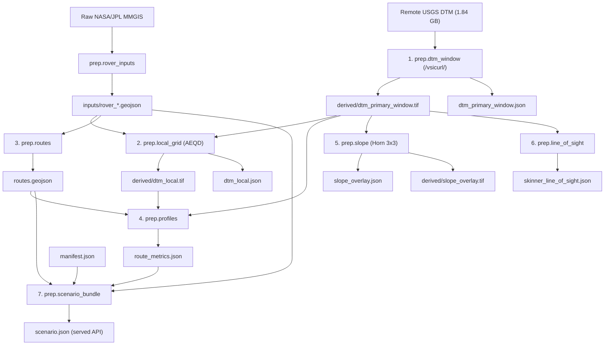

# Hawksbill Gap dataset preparation runbook

This document defines the step-by-step reproducible pipeline to regenerate the complete Hawksbill Gap (`hawksbill-gap`) dataset from raw NASA and USGS planetary science sources. It specifies input data acquisition, pinned cryptographic hashes, the exact execution sequence of preparation scripts in `backend/prep/`, output artifact specifications, and automated verification tests in `backend/tests/`.

---

## 1. Overview and Architecture

The Hawksbill Gap dataset models an astronaut EVA traverse at the front of Jezero Crater's western fan, based on historical Mars 2020 Perseverance rover drives between sols 449 and 502. The dataset supports terrain rendering, elevation profiling, slope overlay analysis, line-of-sight checks, and route evaluation across two options:

- **Option A**: Wildcat Ridge via a proposed straight 5.2 m connector (sols 449, 455, 456, 460, 461, 501, 502; 258.01 m round-trip).
- **Option B**: Skinner Ridge direct inspection, then Wildcat Ridge (sols 449, 455, 456, 460, 461, 464, 474, 477, 501, 502; 345.28 m round-trip).

### Architecture Principles

1. **Cited, real planetary data only**: All data originates from official NASA PDS, USGS Astrogeology, or NASA Mars Trek archives. No synthetic or extrapolated topography is used for primary terrain.
2. **Stateless production runtime**: The production FastAPI backend (`backend/app/main.py`) serves pre-bundled JSON documents (`backend/data/hawksbill_gap/scenario.json`). It does not run GDAL, download rasters, or recompute geometry on requests.
3. **Decoupled preparation pipeline**: Heavy geospatial dependencies (`rasterio`, GDAL, NumPy) are isolated to the `prep` dependency group in `backend/pyproject.toml`. They run offline during dataset builds.
4. **Deterministic and verifiable**: Outputs are pinned by SHA-256 hashes, validated against analytical test fixtures, and verified with `pytest backend/tests/`.

### Spatial Conventions and Reference Frames

| Parameter                   | Value                                                                                  | Reference / Notes                                                                                                  |
| --------------------------- | -------------------------------------------------------------------------------------- | ------------------------------------------------------------------------------------------------------------------ |
| **Reference Body**          | Mars                                                                                   | Spherical model                                                                                                    |
| **Reference Radius ($R$)**  | $3,396,190\text{ m}$                                                                   | IAU standard Mars sphere                                                                                           |
| **Geographic Frame**        | Planetocentric latitude, positive-east longitude                                       | Domain: $[-180^\circ, +180^\circ]$                                                                                 |
| **Coordinate Order**        | `[longitude, latitude, elevation]`                                                     | Standard GeoJSON format                                                                                            |
| **Primary DTM Projection**  | Mars Equirectangular (`IAU2000:104905`)                                                | $\phi_{\text{ts}} = 0^\circ, \lambda_0 = 0^\circ, x_0 = 0, y_0 = 0$, $1.0\text{ m/px}$, $59,274.6975\text{ m/deg}$ |
| **Local Metric Projection** | Spherical Azimuthal Equidistant (`aeqd`)                                               | Center: $(77.406^\circ\text{E}, 18.459^\circ\text{N})$, $x_0 = 0, y_0 = 0$, $1.0\text{ m/px}$                      |
| **Vertical Reference**      | Mars areoid (MOLA geoid, DeltaGeoid)                                                   | Elevations in metres; agrees with rover `elev_geoid` to median $-0.010\text{ m}$                                   |
| **Scenario Extent**         | $77.402^\circ\text{–}77.410^\circ\text{E}$, $18.455^\circ\text{–}18.463^\circ\text{N}$ | Working crop: roughly $450\text{ m} \times 474\text{ m}$ ($474 \times 474$ DTM cells)                              |

---

## 2. Raw Input Sources and Pinned Cryptographic Hashes

All source files are recorded in [`backend/data/hawksbill_gap/manifest.json`](../backend/data/hawksbill_gap/manifest.json) and [`specs/martian-map-scope-2026.md`](martian-map-scope-2026.md).

### Source Inventory

| Input ID                | Product Identifier                                                            | Provider / Archive                        | URL                                                                                                                                                                                                                                                                                                                                                                                        | Pinned SHA-256                                                                                                                                            | Local Target                                                                                                          |
| ----------------------- | ----------------------------------------------------------------------------- | ----------------------------------------- | ------------------------------------------------------------------------------------------------------------------------------------------------------------------------------------------------------------------------------------------------------------------------------------------------------------------------------------------------------------------------------------------ | --------------------------------------------------------------------------------------------------------------------------------------------------------- | --------------------------------------------------------------------------------------------------------------------- |
| `dtm-primary`           | `JEZ_hirise_soc_006_DTM_MOLAtopography_DeltaGeoid_1m_Eqc_latTs0_lon0_blend40` | USGS Astrogeology (Fergason et al., 2020) | [USGS GeoTIFF](https://planetarymaps.usgs.gov/mosaic/mars2020_trn/HiRISE/JEZ_hirise_soc_006_DTM_MOLAtopography_DeltaGeoid_1m_Eqc_latTs0_lon0_blend40.tif)                                                                                                                                                                                                                                  | Remote: 1,839,545,409 bytes.<br>Window float32 raw bytes:<br>`7ce97bbca7772929d1b95d92403eb5c246caa8166df846275f05605a02ee68b7`                           | `backend/data/hawksbill_gap/derived/dtm_primary_window.tif` (git-ignored)                                             |
| `m20-waypoints`         | `M20_waypoints`                                                               | NASA/JPL MMGIS                            | [NASA MMGIS Waypoints](https://mars.nasa.gov/mmgis-maps/M20/Layers/json/M20_waypoints.json)                                                                                                                                                                                                                                                                                                | `bd143ee69241229926abd373e6305b8bbb326d6b5a7b4a8d6935262696f93dc4`                                                                                        | `backend/data/hawksbill_gap/inputs/rover_waypoints.geojson`                                                           |
| `m20-traverse`          | `M20_traverse`                                                                | NASA/JPL MMGIS                            | [NASA MMGIS Traverse](https://mars.nasa.gov/mmgis-maps/M20/Layers/json/M20_traverse.json)                                                                                                                                                                                                                                                                                                  | `6ddd0ece913d75b45d105946082f95ed84e68f4718b68d32a4421dc30877e7e6`                                                                                        | `backend/data/hawksbill_gap/inputs/rover_traverse.geojson`                                                            |
| `supercam-berry-hollow` | `scam_0515_..._berry_hollow_515_sca_01p`                                      | NASA PDS Geosciences (SuperCam, Sol 515)  | [PDS4 FITS](https://pds-geosciences.wustl.edu/m2020/urn-nasa-pds-mars2020_supercam/data_calibrated_spectra/sol_00515/scam_0515_0712658963_589_cp2_scam01515_berry_hollow_515_sca_01p01.fits)<br>[PDS4 XML](https://pds-geosciences.wustl.edu/m2020/urn-nasa-pds-mars2020_supercam/data_calibrated_spectra/sol_00515/scam_0515_0712658963_589_cp2_scam01515_berry_hollow_515_sca_01p01.xml) | FITS:<br>`dee0cc72ebc135cbf3e0776a7632a2a994fd23368e726a906496b1a1cd1eff39`<br>XML:<br>`3efc7c2a31339f98f76fec42cdf71c03e3cb0f59a0d34aed31bcf311197225fd` | Pinned metadata in `manifest.json` & [`specs/hawksbill-gap/supercam-products.md`](hawksbill-gap/supercam-products.md) |
| `supercam-thornton-gap` | `scam_0493_..._thornton_gap_493_sca_01p`                                      | NASA PDS Geosciences (SuperCam, Sol 493)  | [PDS4 FITS](https://pds-geosciences.wustl.edu/m2020/urn-nasa-pds-mars2020_supercam/data_calibrated_spectra/sol_00493/scam_0493_0710705884_778_cp2_scam01493_thornton_gap_493_sca_01p01.fits)<br>[PDS4 XML](https://pds-geosciences.wustl.edu/m2020/urn-nasa-pds-mars2020_supercam/data_calibrated_spectra/sol_00493/scam_0493_0710705884_778_cp2_scam01493_thornton_gap_493_sca_01p01.xml) | FITS:<br>`a49a69245ef0d6ba4a8452585040dab3ae42fe0ded019f0fe8889cc55514f8fd`<br>XML:<br>`6cf23fcd74e30714d784c9fa81636a874d3fea61cd1e97014ca06bedd82f3a44` | Pinned metadata in `manifest.json` & [`specs/hawksbill-gap/supercam-products.md`](hawksbill-gap/supercam-products.md) |
| `pds-initial-reports`   | `Initial Reports, Vol. 2, Rel. 2`                                             | NASA PDS Geosciences Node                 | [Initial Reports PDF](https://pds-geosciences.wustl.edu/missions/mars2020/Mars%202020%20Initial%20Reports%20Volume%202%20Release%202.pdf)                                                                                                                                                                                                                                                  | Cited report                                                                                                                                              | Sections 11 (Swift Run), 14 (Hazeltop), 15 (Bearwallow)                                                               |
| `ortho-hirise`          | `JEZ_hirise_soc_006_..._first_dd`                                             | NASA Mars Trek WMTS                       | [WMTS Capabilities](https://trek.nasa.gov/tiles/Mars/EQ/JEZ_hirise_soc_006_orthoMosaic_25cm_Eqc_latTs0_lon0_first_dd/1.0.0/WMTSCapabilities.xml)                                                                                                                                                                                                                                           | Public WMTS service                                                                                                                                       | Layer in frontend map catalog                                                                                         |
| `meda`                  | Mars 2020 MEDA archive                                                        | NASA PDS Atmospheres Node                 | [MEDA PDS Archive](https://pds-atmospheres.nmsu.edu/data_and_services/atmospheres_data/PERSEVERANCE/meda.html)                                                                                                                                                                                                                                                                             | Archived products sols 490–516                                                                                                                            | Summarized into `backend/data/hawksbill_gap/environment.json`                                                         |
| `rad`                   | Curiosity RAD                                                                 | NASA MSL Science Team                     | [RAD Summary](https://science.nasa.gov/resource/radiation-measurements-on-mars/)                                                                                                                                                                                                                                                                                                           | Published radiation context                                                                                                                               | Summarized into `backend/data/hawksbill_gap/environment.json`                                                         |

### Input Acquisition Commands

#### 1. Rover Traverse and Waypoints (Automated Snapshot)

The rover drive and waypoint collections are acquired and filtered to the scenario extent by running `prep.rover_inputs`. To fetch and verify the raw inputs directly:

```sh
# Fetch raw MMGIS layers
curl -sS -H "User-Agent: crimson-horizon-prep" \
  -o M20_waypoints.json \
  https://mars.nasa.gov/mmgis-maps/M20/Layers/json/M20_waypoints.json

curl -sS -H "User-Agent: crimson-horizon-prep" \
  -o M20_traverse.json \
  https://mars.nasa.gov/mmgis-maps/M20/Layers/json/M20_traverse.json

# Verify cryptographic hashes
echo "bd143ee69241229926abd373e6305b8bbb326d6b5a7b4a8d6935262696f93dc4 *M20_waypoints.json" | sha256sum -c -
echo "6ddd0ece913d75b45d105946082f95ed84e68f4718b68d32a4421dc30877e7e6 *M20_traverse.json" | sha256sum -c -
```

Then snapshot the subset for Hawksbill Gap:

```sh
cd backend
uv run python -m prep.rover_inputs
```

This writes:

- [`backend/data/hawksbill_gap/inputs/rover_waypoints.geojson`](../backend/data/hawksbill_gap/inputs/rover_waypoints.geojson)
- [`backend/data/hawksbill_gap/inputs/rover_traverse.geojson`](../backend/data/hawksbill_gap/inputs/rover_traverse.geojson)
- [`backend/data/hawksbill_gap/inputs/rover_inputs.json`](../backend/data/hawksbill_gap/inputs/rover_inputs.json)

#### 2. Primary USGS DTM Window Acquisition

The primary DTM mosaic is a 1.84 GB GeoTIFF (`JEZ_hirise_soc_006_DTM_MOLAtopography_DeltaGeoid_1m_Eqc_latTs0_lon0_blend40.tif`). To avoid downloading the entire mosaic, the pipeline extracts only the $474 \times 474$ cell window over HTTP byte-range requests via GDAL `/vsicurl/` in `prep.dtm_window`:

- **Column Offset (`col_off`)**: `10614`
- **Row Offset (`row_off`)**: `12229`
- **Width**: `474` cells ($1\text{ m}$ spacing)
- **Height**: `474` cells ($1\text{ m}$ spacing)

---

## 3. Environment Setup and Prerequisites

### Requirements

- **Python**: 3.12+
- **uv**: Fast Python package installer and runner
- **Node.js**: 24+
- **npm**: Frontend package manager

### Backend Setup

The backend configuration in [`backend/pyproject.toml`](../backend/pyproject.toml) organizes dependencies into distinct groups:

- `dependencies`: `fastapi`, `uvicorn[standard]` (stateless production runtime).
- `dependency-groups.dev`: `pytest`, `httpx`, `ruff` (testing and linting).
- `dependency-groups.prep`: `rasterio>=1.5.2` (offline geospatial preparation with GDAL wheels).

Synchronize dependencies including developer and preparation groups:

```sh
cd backend
uv sync --group prep --group dev
```

---

## 4. Execution Sequence of Preparation Pipeline

The offline preparation scripts in [`backend/prep/`](../backend/prep/) must be executed in the exact sequential order listed below. Each stage depends strictly on the artifacts generated by preceding stages.



### Complete Pipeline Run Command

Run all preparation steps sequentially from `backend/`:

```sh
cd backend
uv run python -m prep.rover_inputs && \
uv run --group prep python -m prep.dtm_window && \
uv run --group prep python -m prep.local_grid && \
uv run python -m prep.routes && \
uv run --group prep python -m prep.profiles && \
uv run --group prep python -m prep.slope && \
uv run --group prep python -m prep.line_of_sight && \
uv run python -m prep.scenario_bundle
```

---

### Step-by-Step Script Specifications

### Step 1: `dtm_window.py`

- **Command**: `uv run --group prep python -m prep.dtm_window`
- **Purpose**: Windowed read of the primary USGS HiRISE DTM mosaic over HTTP range requests using GDAL `/vsicurl/`.
- **Inputs**:
  - `manifest.json` (`dtm-primary` metadata and window offsets).
  - Remote USGS GeoTIFF.
- **Outputs**:
  - `backend/data/hawksbill_gap/derived/dtm_primary_window.tif` (Deflate-compressed single-band float32 GeoTIFF).
  - `backend/data/hawksbill_gap/dtm_primary_window.json` (Extraction record, bounding box, min/max/mean elevation, SHA-256).
- **Validation**:
  - Total cells: $224,676$ ($474 \times 474$).
  - Valid cells: $224,676$ ($100\%$ valid, 0 NoData).
  - Elevation range: $-2545.207\text{ m}$ to $-2468.580\text{ m}$ (mean $-2513.105\text{ m}$).
  - Raw pixel bytes SHA-256: `7ce97bbca7772929d1b95d92403eb5c246caa8166df846275f05605a02ee68b7`.

### Step 2: `local_grid.py`

- **Command**: `uv run --group prep python -m prep.local_grid`
- **Purpose**: Resample the equirectangular crop onto a true 1 m metric grid in local Azimuthal Equidistant (`aeqd`) projection centered on $(77.406^\circ\text{E}, 18.459^\circ\text{N})$.
- **Inputs**:
  - `backend/data/hawksbill_gap/derived/dtm_primary_window.tif`
  - `backend/data/hawksbill_gap/inputs/rover_waypoints.geojson`
- **Outputs**:
  - `backend/data/hawksbill_gap/derived/dtm_local.tif` (475 rows $\times$ 451 columns).
  - `backend/data/hawksbill_gap/dtm_local.json` (Resampling record, control point verification).
- **Validation**:
  - Bilinear resampling without filling NoData.
  - Corner cells outside the source crop remain NoData ($925$ cells). Valid cells: $213,300$.
  - Control points (`25_446`, `26_1004`, `26_1222`, and center) map to correct cells and match source elevation within $0.0015\text{ m}$.
  - Synthetic NoData hole check preserves missing cells.

### Step 3: `routes.py`

- **Command**: `uv run python -m prep.routes`
- **Purpose**: Assemble route options from historical Perseverance drive features and proposed connection geometry.
- **Inputs**:
  - `backend/data/hawksbill_gap/inputs/rover_traverse.geojson`
  - `backend/data/hawksbill_gap/inputs/rover_waypoints.geojson`
- **Outputs**:
  - `backend/data/hawksbill_gap/routes.geojson` (GeoJSON FeatureCollection with outbound and return pieces).
- **Validation**:
  - Option A: Outbound $129.00\text{ m}$, Round-trip $258.01\text{ m}$. Includes 5.20 m proposed connector from sol 461 terminus to sol 501 vertex 8.
  - Option B: Outbound $172.64\text{ m}$, Round-trip $345.28\text{ m}$. Follows historical drives through Skinner Ridge (`26_1004`).
  - Return legs mirror outbound geometry.

### Step 4: `profiles.py`

- **Command**: `uv run --group prep python -m prep.profiles`
- **Purpose**: Sample elevation profiles along routes, compute round-trip cumulative ascent, determine maximum absolute grade across multiple windows (2 m, 5 m, 10 m), evaluate DTM coverage, and cross-check against the local grid.
- **Inputs**:
  - `backend/data/hawksbill_gap/routes.geojson`
  - `backend/data/hawksbill_gap/derived/dtm_primary_window.tif`
  - `backend/data/hawksbill_gap/derived/dtm_local.tif`
- **Outputs**:
  - `backend/data/hawksbill_gap/route_metrics.json`
- **Validation**:
  - Matches locked scope table values exactly:
    - **Option A**: Ascent $13.34\text{ m}$; Max grade 2 m: $20.69^\circ$, 5 m: $14.82^\circ$, 10 m: $14.15^\circ$; Coverage: $100.0\%$.
    - **Option B**: Ascent $17.80\text{ m}$; Max grade 2 m: $22.13^\circ$, 5 m: $14.93^\circ$, 10 m: $13.95^\circ$; Coverage: $100.0\%$.
  - Local grid cross-check confirms consistency within $0.05\text{ m}$ on ascent and $<1.6^\circ$ on 2 m grade.

### Step 5: `slope.py`

- **Command**: `uv run --group prep python -m prep.slope`
- **Purpose**: Compute local surface slope across the $474 \times 474$ DTM window using Horn's $3 \times 3$ finite-difference convolution kernel (Horn 1981).
- **Inputs**:
  - `backend/data/hawksbill_gap/derived/dtm_primary_window.tif`
  - `backend/data/hawksbill_gap/dtm_primary_window.json`
- **Outputs**:
  - `backend/data/hawksbill_gap/slope_overlay.json` (Compact 2D nested array with per-row serialization).
  - `backend/data/hawksbill_gap/derived/slope_overlay.tif` (Single-band float32 GeoTIFF, NoData = -9999.0).
- **Validation**:
  - Outer border cells (1 px rim) are marked invalid (`null` in JSON, -9999.0 in GeoTIFF).
  - Valid cells: $222,784$ ($472 \times 472$).
  - Slope degrees distribution: min $0.00^\circ$, max $55.19^\circ$, mean $8.97^\circ$, median $7.00^\circ$, 95th percentile $23.37^\circ$.
  - Validated against analytical planar test fixtures (e.g. 1 m rise per 1 m cell yields $45.0^\circ$).

### Step 6: `line_of_sight.py`

- **Command**: `uv run --group prep python -m prep.line_of_sight`
- **Purpose**: Quantify line-of-sight visibility and topographic obstruction from Option A observation standpoints (~22 m southwest) toward the Skinner Ridge sandstone sample target (Swift Run core at sol 490, $[77.40617078^\circ\text{E}, 18.458931^\circ\text{N}]$).
- **Inputs**:
  - `backend/data/hawksbill_gap/derived/dtm_primary_window.tif`
  - `manifest.json`
- **Outputs**:
  - `backend/data/hawksbill_gap/skinner_line_of_sight.json`
- **Validation**:
  - Observer eye height: $1.5\text{ m}$ above ground.
  - Target height $0.0\text{ m}$ (basal contact): **OBSTRUCTED** by $0.072\text{ m}$ to $0.149\text{ m}$ due to intervening terrain crest.
  - Target height $+0.5\text{ m}$ (mid-block face): **CLEAR** with $+0.281\text{ m}$ to $+0.368\text{ m}$ clearance.
  - Target height $+1.0\text{ m}$ (block top): **CLEAR** with $+0.711\text{ m}$ to $+0.808\text{ m}$ clearance.
  - Geologic conclusion: Contact continuity cannot be verified from Option A; direct inspection via Option B is mandatory.

### Step 7: `scenario_bundle.py`

- **Command**: `uv run python -m prep.scenario_bundle`
- **Purpose**: Consolidate manifest metadata, routes, rover drives, elevation profiles, caution zones, and obstacles into the single served scenario bundle.
- **Inputs**:
  - `manifest.json`
  - `backend/data/hawksbill_gap/routes.geojson`
  - `backend/data/hawksbill_gap/inputs/rover_traverse.geojson`
  - `backend/data/hawksbill_gap/inputs/rover_waypoints.geojson`
  - `backend/data/hawksbill_gap/route_metrics.json`
- **Outputs**:
  - `backend/data/hawksbill_gap/scenario.json` (Document served by `GET /scenarios/hawksbill-gap`).
- **Validation**:
  - Schema version `1.2`.
  - 8 route pieces, 10 drives, 2 profiles, 9 caution zones, 2 obstacles.
  - Passes schema validation via `app.scenario_schema.validate_scenario`.

---

### Ancillary Context Preparation Scripts

The following scripts generate supplementary context records for environmental data and imagery verification:

| Script                    | Command                                              | Output File                                            | Purpose                                                                                                                |
| ------------------------- | ---------------------------------------------------- | ------------------------------------------------------ | ---------------------------------------------------------------------------------------------------------------------- |
| `elevation_check.py`      | `uv run --group prep python -m prep.elevation_check` | `backend/data/hawksbill_gap/elevation_check.json`      | Cross-checks 25 rover localization waypoints against primary DTM elevations. Confirms areoid vertical datum agreement. |
| `hirise_wmts_coverage.py` | `uv run python -m prep.hirise_wmts_coverage`         | `backend/data/hawksbill_gap/hirise_wmts_coverage.json` | Validates Mars Trek WMTS tile matrix coverage, CORS headers, and zoom level availability across Hawksbill Gap.         |
| `environment_context.py`  | `uv run python -m prep.environment_context`          | `backend/data/hawksbill_gap/environment.json`          | Summarizes Mars 2020 MEDA atmospheric measurements (sols 490–516) and Curiosity RAD radiation levels.                  |

---

## 5. Output Artifacts, Expected File Sizes, and Formats

All output files reside in `backend/data/hawksbill_gap/`. Heavy intermediate rasters in `derived/` are git-ignored and regenerated offline.

| Path                             | Tracking    | Format  | Expected Size | Key Content / Schema                                                     |
| -------------------------------- | ----------- | ------- | ------------- | ------------------------------------------------------------------------ |
| `manifest.json`                  | Committed   | JSON    | ~15 KB        | Source manifest (v1.0), coordinate systems, spatial extents, citations   |
| `inputs/rover_inputs.json`       | Committed   | JSON    | ~1.2 KB       | Snapshot provenance, drive sol mappings, pinned source hashes            |
| `inputs/rover_traverse.geojson`  | Committed   | GeoJSON | ~23 KB        | Historical traverse line segments for sols 449–502                       |
| `inputs/rover_waypoints.geojson` | Committed   | GeoJSON | ~38 KB        | Rover localization points within extent (`25_446`, `26_1004`, `26_1222`) |
| `dtm_primary_window.json`        | Committed   | JSON    | ~2.2 KB       | Crop coordinates, bounds, min/max/mean elevation, SHA-256 hash           |
| `derived/dtm_primary_window.tif` | Git-ignored | GeoTIFF | ~543 KB       | 474 $\times$ 474 Float32 Equirectangular DTM crop (Deflate compressed)   |
| `dtm_local.json`                 | Committed   | JSON    | ~3.9 KB       | AEQD grid metadata, control point residuals, hole test results           |
| `derived/dtm_local.tif`          | Git-ignored | GeoTIFF | ~535 KB       | 475 $\times$ 451 Float32 Azimuthal Equidistant local grid                |
| `routes.geojson`                 | Committed   | GeoJSON | ~66 KB        | Route options A and B with outbound, connector, and return LineStrings   |
| `route_metrics.json`             | Committed   | JSON    | ~16 KB        | Elevation profiles, ascent, max grade (2/5/10 m), caution metrics        |
| `slope_overlay.json`             | Committed   | JSON    | ~1.18 MB      | Compact 2D array of slope values in degrees (Horn 1981 kernel)           |
| `derived/slope_overlay.tif`      | Git-ignored | GeoTIFF | ~468 KB       | 474 $\times$ 474 Float32 slope GeoTIFF in degrees (NoData = -9999.0)     |
| `skinner_line_of_sight.json`     | Committed   | JSON    | ~188 KB       | Sightline clearances, critical point coordinates, multi-height profiles  |
| `scenario.json`                  | Committed   | JSON    | ~51 KB        | Complete v1.2 scenario document served by the API                        |
| `elevation_check.json`           | Committed   | JSON    | ~8.9 KB       | 25-localization elevation cross-check residuals against rover waypoints  |
| `environment.json`               | Committed   | JSON    | ~165 KB       | Archival MEDA atmospheric profiles (sols 490–516) and RAD context        |
| `hirise_wmts_coverage.json`      | Committed   | JSON    | ~6.7 KB       | Mars Trek HiRISE WMTS tile verification and CORS checks                  |

---

## 6. Verification Checks and Automated Test Suite

Verification is automated through pytest in `backend/tests/`. The test suite operates entirely against committed metadata, records, and synthetic fixtures without requiring external network connectivity or rasterio.

### Running the Test Suite

From the `backend/` directory:

```sh
cd backend
uv run pytest
```

Expected output: **256 passed** (0 failures).

### Test Suite Mapping

| Test Module                              | Component Verified                               | Key Assertions / Tolerances                                                                                                                                        |
| ---------------------------------------- | ------------------------------------------------ | ------------------------------------------------------------------------------------------------------------------------------------------------------------------ |
| `tests/test_source_manifest.py`          | `manifest.json`                                  | Verifies spatial extent, coordinate order (`[lon, lat]`), planetocentric conventions, reference sphere radius ($3,396,190\text{ m}$), and SHA-256 hash formatting. |
| `tests/test_prep_inputs.py`              | `rover_inputs.py`, `dtm_window.py`               | Validates waypoint filtering, traverse segment sol mapping, primary window bounds coverage ($474 \times 474$ cells), and absence of extraction findings.           |
| `tests/test_dtm_window.py`               | `dtm_window.py`, `dtm_primary_window.json`       | Tests NoData masking semantics ($-3.4028\times 10^{38}$), out-of-bounds queries, grid boundaries, and bilinear interpolation behavior.                             |
| `tests/test_local_grid_and_routes.py`    | `local_grid.py`, `routes.py`                     | Verifies forward AEQD projection math, round-trip cell coordinate mapping, control point elevations within $0.01\text{ m}$, and route segment continuity.          |
| `tests/test_route_metrics.py`            | `profiles.py`, `route_metrics.json`              | Checks locked scope metrics: Option A ascent $13.34\text{ m}$, Option B ascent $17.80\text{ m}$, max grades at 2/5/10 m, and local grid tolerances.                |
| `tests/test_route_metrics_controlled.py` | Controlled synthetic tests                       | Tests profile interpolation, grade binning, gap detection, and cumulative distance formulas against synthetic linear ramp grids.                                   |
| `tests/test_slope.py`                    | `slope.py`, `slope_overlay.json`                 | Tests Horn 3×3 finite-difference algorithm against analytical $45.0^\circ$ and $11.31^\circ$ ramps, verifies border masking (`null`), and checks overlay values.   |
| `tests/test_line_of_sight.py`            | `line_of_sight.py`, `skinner_line_of_sight.json` | Verifies great-circle azimuth, sightline ray interpolation, barrier obstruction formulas, and checks committed Skinner Ridge visibility results.                   |
| `tests/test_elevation_check.py`          | `elevation_check.py`                             | Checks DTM vs rover localization elevation residuals across 25 points (median $-0.010\text{ m}$, standard deviation $0.066\text{ m}$).                             |
| `tests/test_supercam_products.py`        | SuperCam spectra                                 | Verifies SuperCam FITS data hashes, PDS4 XML label hashes, observation sols (515 and 493), and target RMC localizations (`26_1222`, `26_1004`).                    |
| `tests/test_environment.py`              | `environment_context.py`                         | Validates MEDA diurnal temperature, surface pressure, wind speed, relative humidity summaries, and Curiosity RAD baseline figures.                                 |
| `tests/test_hirise_wmts.py`              | `hirise_wmts_coverage.py`                        | Validates Mars Trek WMTS tile matrix structure, level 17 max zoom, and CORS accessibility.                                                                         |
| `tests/test_scenario.py`                 | `scenario_bundle.py`, `app/scenario.py`          | Validates scenario endpoint (`/scenarios/hawksbill-gap`), GeoJSON validity, coordinate ranges, and stop metadata.                                                  |
| `tests/test_scenario_validation.py`      | `app/scenario_schema.py`                         | Verifies schema validation, rejects broken bundles (503 status), and ensures backwards compatibility for additive minor fields.                                    |
| `tests/test_release.py`                  | Deployment regressions                           | Checks cold-start handling, CORS origin headers (`LOCAL_ORIGIN`, `PAGES_ORIGIN`), and preflight OPTIONS handling.                                                  |

---

## 7. Troubleshooting and Failure Recovery

### GDAL `/vsicurl/` Range Request Timeouts

If `prep.dtm_window` fails with network timeouts when accessing the remote USGS GeoTIFF:

1. Confirm outbound HTTPS connectivity to `https://planetarymaps.usgs.gov`.
2. Ensure GDAL environment variables permit HTTP retries:
   ```sh
   export GDAL_HTTP_MAX_RETRY=5
   export GDAL_HTTP_RETRY_DELAY=3
   uv run --group prep python -m prep.dtm_window
   ```

### Hash Verification Mismatches

If `prep.rover_inputs` reports a hash mismatch:

- NASA/JPL occasionally appends newly localized drives to `M20_waypoints.json` or `M20_traverse.json`.
- Compare the reported hash against `manifest.json`.
- The Hawksbill Gap snapshot relies strictly on historical sols 449–502 and RMCS `25_446`, `26_1004`, `26_1222`, which remain immutable in the historical archive.

### Missing Derived Rasters in Development

If running scripts that require DTM rasters (`profiles.py`, `slope.py`, `line_of_sight.py`):

- Ensure Step 1 (`dtm_window.py`) and Step 2 (`local_grid.py`) have run to populate `backend/data/hawksbill_gap/derived/`.
- Note that `derived/` is intentionally excluded from git commits per [`.gitignore`](../.gitignore).
