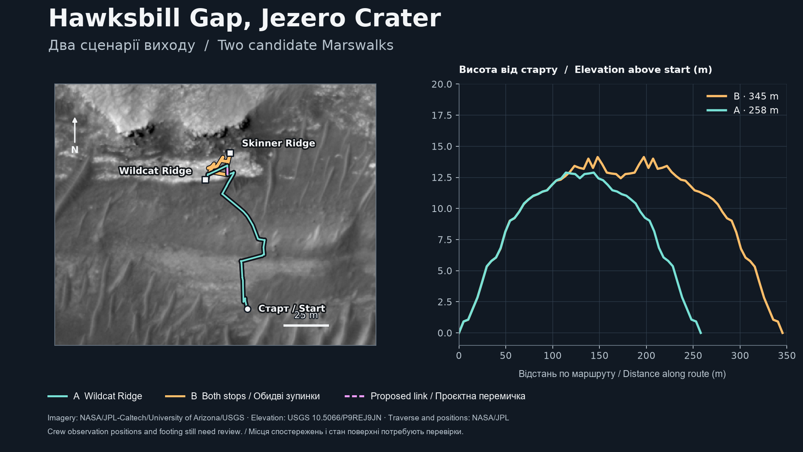

# CrimsonHorizon — NASA Space Apps Challenge 2026

## Proposal

I propose **Hawksbill Gap** on the front of Jezero Crater’s western fan. The crew plans a short Marswalk to Wildcat Ridge and Skinner Ridge, compares the rocks, and decides where to spend field time testing a geologic interpretation. The map answers two linked questions: can the crew walk the route safely, and is the science worth the extra distance? Caution zones along the route, obstacles, a turnaround point, and archival surface conditions cover safety. This is a proposed hackathon scenario built around archival mission data. [NASA’s two sampling locations][photo] · [Challenge brief][challenge]

## Target audience

| Audience                                                                                                           | Decision the product supports                                                                                                                                                                                                                                              |
| ------------------------------------------------------------------------------------------------------------------ | -------------------------------------------------------------------------------------------------------------------------------------------------------------------------------------------------------------------------------------------------------------------------- |
| **Primary — an astronaut field geologist and their crewmate planning a surface excursion from a habitat or rover** | Select science stops, observation positions, and a return leg before the excursion. In the field, use annotated rover photos to recognize targets and read the task for each stop. The interface is a desktop/tablet planner and the field product is a static crew brief. |
| **Secondary — science support teams and EVA planners**                                                             | Trace claims to mission evidence, compare science yield with the terrain profile, and prepare a fallback. NASA’s BASALT tests give precedent for these roles. [NASA BASALT][basalt] · [BASALT field decision-making study][decision]                                       |
| **Demo audience — Space Apps judges, analog mission teams, and planetary-science students**                        | Follow a single scenario and explain what each stop contributes and why a crew might revise the plan. A geologist or fieldwork participant and several technical users can serve as usability-test proxies.                                                                |

## Scientific contribution

**Field question.** Is the Skinner Ridge block part of the lower Rockytop bedrock it sits in, or a float block that came down from upper Rockytop? The initial Swift Run report treated the block as likely in place because its bedding parallels most Rockytop bedding. Williams and colleagues in 2026 classified it as float from the upper Rockytop facies. Their argument is facies-based: alternating protruding and recessive layers like upper Rockytop, a contrast with the light-toned, thin-bedded lower Rockytop, and a composition similar to Betty’s Rock. Parallel bedding cannot separate the two readings. The crew checks two things: whether beds continue across the edge of the block into adjacent outcrop (the deciding observation), and which facies the block resembles (supporting evidence). If the contact is covered, the result stays unresolved, with a list of what is missing. Veins at Wildcat Ridge are a separate task for the reference stop and concern post-depositional change. [PDS Swift Run and Hazeltop reports, sections 11 and 14][pds] · [Williams et al., 2026][williams] · [Stack et al., 2024][stack] · [Crew field objective](hawksbill-gap/field-objective.md)

**The team’s contribution is a reproducible way to connect a field decision to evidence from two missions.** Orbital imagery locates the terrain and approach, a numerical terrain model supplies a profile, and Perseverance provides local rock measurements. The map links all three types to a field task and preserves their sources, scales, and uncertainty. A new field record would distinguish camera position from target position and capture viewing direction, scale, surface condition, and what can be seen at the contact. Observations across the exposure could test whether a feature continues beyond the rover’s measurement point. Ancient water and the potential for biosignature preservation remain geological interpretations. [Broz et al., 2024][broz] · [Orbital vs. rover measurements, Kanine et al., 2026][kanine]

**The field output** is a set of scale photographs and a record of the contact. If bedding continues across it, record where it can be followed. If the block is detached and its layering matches a nearby Upper Rockytop exposure, record the basis for that match. If the view is incomplete, mark the result as unresolved and identify the next viewpoint to try. This kind of observation-led fieldwork is consistent with the 2026 science strategy for human exploration of Mars. The strategy gives science objectives and site criteria. Hawksbill Gap is this prototype’s proposed site. [National Academies strategy][nasstrategy] · [Williams et al., 2026][williams]

## Science stops and crew decisions

NASA’s side-by-side images of the two abrasion patches show rock textures at a comparable scale. Williams et al.’s figure S3 compares bedding at Upper Rockytop, Betty’s Rock, and Skinner Ridge using roughly 2 cm scale bars. That gives the crew a reference for the photographs to take. Bosak and colleagues provide site panoramas and links to 3D workspace models. [NASA’s paired abrasion images][abrasion] · [Williams et al., fig. S3][williams-supplement] · [Bosak et al., figs. 3 and 5][bosak]

| Stop                                | Mission evidence                                                                                                                                                                                                                          | Proposed field task                                                                                                                                                                                                                                           |
| ----------------------------------- | ----------------------------------------------------------------------------------------------------------------------------------------------------------------------------------------------------------------------------------------- | ------------------------------------------------------------------------------------------------------------------------------------------------------------------------------------------------------------------------------------------------------------- |
| **Wildcat Ridge / Hogwallow Flats** | Hazeltop core location, sol 509. PDS reports 18.45863707° N, 77.40588851° E. The rover also collected Bearwallow here on sol 516. Show the fine-grained sulfate-bearing rock and a close-up of a vein or the Berry Hollow abrasion patch. | Record whether veins cut across bedding. Take a scale photo that includes the vein and surrounding rock to help test which features formed after deposition. [PDS, section 14, figs. 5, 21–22][pds] · [NASA, PIA24929][cores]                                 |
| **Skinner Ridge / Rockytop**        | Swift Run core location, sol 490. PDS reports 18.458931° N, 77.40617078° E. The rover also collected Skyland here on sol 495. Sandstone, with imaging of bedding and SuperCam measurements around the Thornton Gap abrasion patch.        | Document bedding orientation and continuity and the contact with surrounding rock. If access or visibility is limited, observe from a checked position or defer field verification. [PDS, section 11, figs. 2–5, 23][pds] · [Williams et al., 2026][williams] |

The listed coordinates represent sample locations. The start, crew observation positions, and route geometry are proposed planning features to check against imagery and the terrain model. NASA describes the two sites as roughly 20 m apart. Route length depends on the selected approach and return. [NASA, PIA24924][photo] · [PDS, sections 11 and 14][pds]

## MVP data

**Spectral data access verified.** I read two calibrated IR FITS products for the abraded surfaces at Berry Hollow (sol 515) and Thornton Gap (sol 493). Each contains 256 wavelength records spanning roughly 1.31–2.59 µm. For a plot, check the quality flags, sort wavelengths, and confirm the units of `I_F_Atm` in the instrument documentation. Cite the mission reports for mineral interpretations. [Berry Hollow][berry] · [Thornton Gap][thornton] · [SuperCam calibration][calibration]

| Type and mission                                 | What the product shows                                                                                                                                                                                                                                     | Scale and limits                                                                                                                                                                                                                                                      |
| ------------------------------------------------ | ---------------------------------------------------------------------------------------------------------------------------------------------------------------------------------------------------------------------------------------------------------- | --------------------------------------------------------------------------------------------------------------------------------------------------------------------------------------------------------------------------------------------------------------------- |
| **Optical — MRO HiRISE and Mars 2020 Mastcam-Z** | HiRISE for the overhead plan. NASA’s annotated PIA24924 image for the surface view of both locations. Optional CTX for crater context.                                                                                                                     | HiRISE orthomosaic at 0.25 m/pixel and CTX at 6 m/pixel. Rover images have their own viewing geometry, time, and scale. [USGS HiRISE][hirise] · [USGS CTX][ctx] · [NASA PIA24924][photo]                                                                              |
| **Topography — USGS model from MRO HiRISE**      | A 1 m numerical terrain model, slope overlay, route elevation profile, and visible data gaps.                                                                                                                                                              | Grid spacing and elevation accuracy are distinct. Slope estimates depend on the calculation window. Narrow ledges, small rocks, and footing need field review. [USGS DTM][dtm] · [HiRISE DTM characteristics][dtmquality]                                             |
| **Spectroscopy — Mars 2020 SuperCam VISIR**      | A point layer of rover observations with published reflectance spectra and brief interpretations. The minimum is two cards based on Hazeltop figure 22 and Swift Run figure 23. Add an in-app plot if the corresponding calibrated products are available. | These are spot measurements. Show target, observation sol, source, and surface condition: natural, abraded, or drill tailings. Compare like surface conditions and keep observations tied to their targets. [PDS Initial Reports][pds] · [SuperCam archive][supercam] |

Two extensions once the MVP works. **Geologic context** — the prelanding 1:5,000 photogeologic map or the USGS 1:75,000 regional map, with source scale and date visible. **Geophysics** — one published RIMFAX section linked to its historical rover track, with gaps and the travel-time-to-depth assumption preserved. [Local map and GIS files][photogeology] · [USGS regional geologic map][geology] · [RIMFAX archive][rimfax] · [Paige et al., 2024][paige]

I checked both sample coordinates against the local map’s GIS supplement. Hazeltop falls in _Delta thinly layered_ and Swift Run in _Delta truncated curvilinear layered_. These are prelanding orbital map units. The polygon containing Swift Run cannot establish the origin of the individual Skinner Ridge block. [Stack et al., local photogeologic map][photogeology]

## Hackathon deliverable

1. **One map area.** Open Hawksbill Gap in the existing OpenLayers map. Use 77.402–77.410° E, 18.455–18.463° N as a working extent for checking coverage, roughly 450 × 474 m. Add legends, dataset credits, and two science cards. Give the crew a compact field brief with stop order, photos, and recognizable features.
2. **One out-and-back scenario.** Compare two prepared options with the same start and finish: visit both sites, or visit Wildcat Ridge with a stand-off look at Skinner Ridge where visibility allows. Show total distance, ascent, slopes, percentage of the route with valid terrain data, and which observations each option enables. A blocked view or uncertain terrain can trigger deferral of the Skinner Ridge field task. A separate layer can show the historical rover route. [NASA/JPL rover localizations][waypoints]
3. **One decision on screen.** The planner opens Skinner Ridge, sees the competing interpretations, reviews the approach, and decides whether to include an observation of the contact. The crew receives a brief with a testable question and a return option.
4. **Visible terrain limits.** Mark unknown coverage and distinguish surface slope from grade along the direction of travel. Review steep or suspicious areas against HiRISE and rover imagery. Present the product as a planning prototype. Crew authorization would require on-site assessment and mission procedures.
5. **A crew safety layer.** See "Crew safety" below.

## Crew safety

The challenge names astronaut safety as NASA's first priority and mentions radiation, spacesuit mobility, and obstacle avoidance. The demo needs four elements, all built from data that is already prepared. [Challenge brief][challenge]

- **Caution zones along the route.** Mark segments without valid terrain, the steepest along-route segments, and option A's connector, where the two terrain models disagree (about 7° against 22°). Show grade at more than one sampling step: about 15° at 5 m, but up to 21–22° at 2 m. There is no cited grade threshold yet for walking in a loaded spacesuit. Until one is sourced, the interface shows grade classes without a "safe" verdict.
- **Obstacles.** Mark large boulders near the route, including Betty’s Rock beside Skinner Ridge, and the crack and overhang on the eastern side of the Skinner Ridge block. The mission report describes both. [PDS, section 11, fig. 5][pds]
- **Turnaround and return.** For each option, show the farthest point from the start and the return leg. An option is cleared only when every caution zone on it has been reviewed. If neither option is cleared, the planner recommends neither and shows what blocks each one.
- **Surface conditions card.** Archival MEDA measurements in Jezero for sols 490–516, when the rover worked at these stops, shown with their dates. Radiation context from RAD, with an explicit note that RAD measured in Gale Crater, not Jezero. This is historical context, not a forecast or an authorization to go. [MEDA][meda] · [Curiosity RAD][rad]

## Build and evaluation

- **Coverage verified by reading the raster.** All 224,676 cells of the 474 × 474 primary GeoTIFF crop were valid. The fallback USGS COG also covered the crop, with different elevation values. After aligning grids, the median fallback-minus-primary difference was +6.7 m. At 25 historical rover localizations across sols 439–502, median differences against `elev_geoid` were about −0.03 m for the primary raster and +9.26 m for the fallback. This checks consistency with mission localizations, which may share an elevation reference with the primary raster. Independent accuracy still needs evaluation. I recommend the primary GeoTIFF for the demo. [USGS GeoTIFF][dtmasset] · [Fallback COG][fallbackstac] · [NASA/JPL rover localizations][waypoints]
- **Preliminary demo measurements.** Option A to Wildcat Ridge, with a proposed 5 m connector, measures about **258 m** round trip. Option B through both stops, using historical Perseverance geometry, measures about **345 m**. At roughly 5 m sampling, maximum along-line grades are about 15° for both variants, and up to 21–22° at 2 m. The demo trade-off is about 87 m of additional travel for a close look at the contact. The shorter option needs a connector review, and the contact is probably not visible from its viewpoint. [NASA/JPL traverse geometry][traverse] · [Terrain source][dtmasset]
- **Prepare the elevation crop for the application.** Use the USGS TRN HiRISE DTM, DOI `10.5066/P9REJ9JN`. Keep `DTEEC_002387_1985_003798_1985_A01` as a fallback after an alignment check. Crop locally, preserve NoData and vertical-reference metadata, and compute in a local metric Mars projection. Verify longitude convention, latitude type, and axis order against each source. The repo has a tile catalog and four reference markers. The proposed analysis needs numeric elevations and additional campaign points. [USGS DTM][dtm] · [HiRISE fallback][backup] · [Current map catalog](../frontend/src/marsCatalog.ts)
- **Precompute both options and their profiles.** Package small versioned results with their provenance. Keep GIS processing on the Python side, serve prepared data through FastAPI, and render it in OpenLayers. The current Cloudflare Pages and Render Free setup is adequate for this proposed demo. Include a prepared local overview if the source’s reuse conditions permit it and the live tile service is unavailable. [CrimsonHorizon architecture](architecture.md) · [JPL image use policy][jpluse]
- **Acceptance checks.** Both sites agree with NASA’s annotations after coordinate alignment. Every intended approach and return has valid elevation coverage or a visible gap. Spot-check several elevations and a profile in an independent GIS viewer. Show how much distance the close inspection of the contact adds. Report scale sensitivity if changing the slope window reverses the comparison. Ask a test user to explain a route choice and identify one unknown without prompting.
- **If the profiles have yet to be integrated.** Preserve a usable science briefing demo with real imagery and spectral evidence, and show the terrain profile and walkability assessment as unavailable. Valid terrain analysis remains a requirement for the complete MVP. Automatic route finding, live telemetry, weather prediction, suit resource estimates, and a helmet HUD are later-stage options.

The demo's conditions card is limited to archival data (see "Crew safety"). Forecasting, operational limits, and crew authorization would require additional sources and models. [MEDA][meda] · [Curiosity RAD][rad]

**Test the crew decision.** Ask an analog mission participant, geologist, or other test user to play the planner. Give them two tasks without help. First, choose an option and name the observation it enables. Then explain what to enter on the field brief if loose material covers the contact. Record time, whether the response matches the evidence, and which source the test user could find. For the second task, the expected result is to leave the question unresolved and identify another viewpoint or defer the check.

**Why this site.** Hawksbill Gap builds on the existing Jezero map and puts two well-documented stops into one scene. Mount Sharp’s boxwork is a viable alternative science case: Curiosity investigated the differences between ridges and hollows, but CrimsonHorizon would need a separate Gale data package and new control points. A global overview still helps users orient themselves before opening the local scenario. [NASA — Boxworks With a View][boxwork]

**Related tools.** Mars Trek offers layered maps and elevation profiles. The Jezero Virtual Hiking Map combines orbital data and panoramas, and the MOMAR prototype compares routes in Jezero and Gale. CrimsonHorizon’s demo should foreground the crew’s decision about a geological hypothesis, show the evidence at individual-rock scale, and specify the observation that could change the interpretation. [NASA Solar System Treks][trektools] · [Jezero Virtual Hiking Map][hiking] · [MOMAR][momar]

## Space Apps submission

The challenge suggests integrating at least three types of data. The demo uses five: optical, topographic, spectral, atmospheric (MEDA), and radiation (RAD, as context). Global judging requires at least one NASA data source or resource. Submit English materials and a public demo of up to 30 seconds or seven slides. Project submissions close on November 15 at 11:59 p.m. in the local time specified by the event rules. Use the demo to show the two nearby targets, the competing interpretation of Skinner Ridge, and a crew decision that weighs route safety and science value together. [Official challenge brief][challenge] · [Project Submission Guide][submission] · [Judging & Awards Guide][judging]

**Build order.** Prepare the local terrain crop, route lines, and profiles while assembling both science cards with their sources, field question, and crew tasks. Then connect the data in one planning screen and field brief. Finish by checking the map, confirming that the public demo link works, and recording the short walkthrough.

| Time    | What to show                                                                                                                |
| ------- | --------------------------------------------------------------------------------------------------------------------------- |
| 0–6 s   | Where the crew works, the conditions card, and which samples connect the two stops to the delta’s history.                  |
| 6–14 s  | Open the Skinner Ridge card. Show the initial interpretation, the 2026 revision, and the bedding photo the crew would take. |
| 14–24 s | Compare 258 m with 345 m, with caution zones and obstacles. The extra distance buys a closer look at the contact.           |
| 24–30 s | Show the field brief with the science question, the turnaround point, the decision, and source links.                       |

**Project summary**

> CrimsonHorizon is a planning prototype for an astronaut geology crew preparing a short Marswalk in Jezero Crater. It combines Mars Reconnaissance Orbiter imagery and terrain data with Perseverance photos, spectroscopy, and archival weather, and adds radiation context. The crew compares two routes by caution zones, obstacles, and return distance, and chooses whether the extra walk is worth testing whether the sandstone block at Skinner Ridge originated in the bed beside it or moved from higher on the ridge.

## Calculation

Both options start at `25_446` and retrace their outbound geometry. A follows sols 449, 455, 456, 460, and 461, adds a straight 5.2 m connector to the ninth vertex of the sol 501 feature, then continues to `26_1222` via sol 502. B follows drives on sols 449, 455, 456, 460, 461, 464, 474, 477, 501, and 502, passing `26_1004` near Skinner Ridge. [NASA/JPL traverse lines][traverse] · [Rover localizations][waypoints]

| Option | Round-trip distance | Ascent at 5 m | Max absolute grade at 2/5/10 m |
| ------ | ------------------: | ------------: | -----------------------------: |
| A      |            258.01 m |       13.34 m |       20.69° / 14.82° / 14.15° |
| B      |            345.28 m |       17.80 m |       22.13° / 14.93° / 13.95° |

Distance sums horizontal great-circle arcs between vertices on a sphere with a radius of 3,396,190 m. Elevation was bilinearly interpolated at evenly spaced points along the outbound path. Round-trip ascent sums absolute outbound elevation changes because each outbound descent becomes a climb on return. Round the values in the demo. [USGS GeoTIFF][dtmasset]

**Visibility.** A rough check over ~22 m from an illustrative eye height of 1.5 m gave 0.15 m of obstruction for a ground-level target and 0.28 m of clearance for a target 0.5 m higher. The block's contact is at ground level, so it is probably not visible from option A. A check against rover imagery is still pending. [USGS GeoTIFF][dtmasset] · [NASA Mastcam-Z][photo]

**Model sensitivity.** At roughly 5 m sampling, the fallback gives maximum along-line grades near 25° for A and 27° for B, compared with about 15° for both on the primary model. At up to 2 m sampling on the connector alone, the primary and fallback give about 7° and 22°, respectively. Review the connector against ground imagery. [USGS GeoTIFF][dtmasset] · [Fallback COG][fallbackstac]

**Orbital imagery.** I retrieved and inspected a mosaic of 49 level-17 Mars Trek tiles covering both stops and the connector. The server allows cross-origin access. [Mars Trek HiRISE WMTS][wmts]

**Reproduction inputs.** Archive snapshot from November 14, 2026. The primary GeoTIFF window starts at zero-based column 10,614 and row 12,229 and spans 474 × 474 cells. [USGS GeoTIFF][dtmasset]

| Input                           | SHA-256                                                            |
| ------------------------------- | ------------------------------------------------------------------ |
| [NASA/JPL traverse][traverse]   | `6ddd0ece913d75b45d105946082f95ed84e68f4718b68d32a4421dc30877e7e6` |
| [NASA/JPL waypoints][waypoints] | `bd143ee69241229926abd373e6305b8bbb326d6b5a7b4a8d6935262696f93dc4` |
| [Berry Hollow][berry] FITS      | `dee0cc72ebc135cbf3e0776a7632a2a994fd23368e726a906496b1a1cd1eff39` |
| [Thornton Gap][thornton] FITS   | `a49a69245ef0d6ba4a8452585040dab3ae42fe0ded019f0fe8889cc55514f8fd` |

## Sources

The station coordinates and geologic interpretations come from archival reports and publications. The working extent, UX, scenario, and route lines are proposals for the team. The numerical crop was checked. Footing, contact visibility, and observation positions remain to be assessed.

- Challenge framing supplied by the team and event dates from the organizers. [NASA Space Apps challenge page][challenge] · [Official 2026 event page][event]
- Regional visualization and interactive maps. [NASA Mars Trek][trek] · [USGS Mars interactive maps][usgsmars] · [NASA Worldview, interface reference][worldview] · [Curiosity route visualization reference][curiosity]
- Surface image discovery. [Perseverance raw image gallery][raw] · [NASA/JPL rover location map][location]

[challenge]: https://www.spaceappschallenge.org/2026/challenges/interplanetary-survival-guide-martian-map/?tab=details
[event]: https://www.spaceappschallenge.org/2026/
[submission]: https://www.spaceappschallenge.org/resources/project-submission-guide/
[judging]: https://www.spaceappschallenge.org/resources/judging-awards-guide/
[photo]: https://science.nasa.gov/photojournal/2-perseverance-sampling-locations-in-jezeros-delta/
[cores]: https://science.nasa.gov/photojournal/perseverance-rock-cores-from-wildcat-ridge/
[abrasion]: https://science.nasa.gov/photojournal/2-abrasion-patches-from-perseverance-at-jezero-delta
[bosak]: https://doi.org/10.1029/2024AV001241
[pds]: https://pds-geosciences.wustl.edu/missions/mars2020/Mars%202020%20Initial%20Reports%20Volume%202%20Release%202.pdf
[williams]: https://www.sciencedirect.com/science/article/abs/pii/S0019103526002277
[williams-supplement]: https://authors.library.caltech.edu/records/3jm2k-zn247/files/1-s2.0-S0019103526002277-mmc1.pdf?download=1
[stack]: https://doi.org/10.1029/2023JE008187
[broz]: https://doi.org/10.1029/2024JE008520
[kanine]: https://doi.org/10.1029/2026EA005086
[nasstrategy]: https://www.nationalacademies.org/read/28594/chapter/2
[basalt]: https://www.nasa.gov/missions/analog-field-testing/what-is-basalt/
[decision]: https://pmc.ncbi.nlm.nih.gov/articles/PMC6442282/
[hirise]: https://astrogeology.usgs.gov/search/map/mars_2020_terrain_relative_navigation_hirise_orthorectified_image_mosaic
[ctx]: https://astrogeology.usgs.gov/search/map/mars_2020_terrain_relative_navigation_context_camera_orthorectified_image_mosaic
[dtm]: https://www.usgs.gov/data/mars-2020-terrain-relative-navigation-hirise-dtm-mosaic
[dtmasset]: https://planetarymaps.usgs.gov/mosaic/mars2020_trn/HiRISE/JEZ_hirise_soc_006_DTM_MOLAtopography_DeltaGeoid_1m_Eqc_latTs0_lon0_blend40.tif
[fallbackstac]: https://stac.astrogeology.usgs.gov/api/collections/mro_hirise_socet_dtms/items/DTEEC_002387_1985_003798_1985_A01
[dtmquality]: https://stac.astrogeology.usgs.gov/docs/data/mars/hirise_dtms/
[backup]: https://www.uahirise.org/dtm/dtm.php?ID=PSP_002387_1985
[supercam]: https://doi.org/10.17189/1522646
[berry]: https://pds-geosciences.wustl.edu/m2020/urn-nasa-pds-mars2020_supercam/data_calibrated_spectra/sol_00515/scam_0515_0712658963_589_cp2_scam01515_berry_hollow_515_sca_01p01.xml
[thornton]: https://pds-geosciences.wustl.edu/m2020/urn-nasa-pds-mars2020_supercam/data_calibrated_spectra/sol_00493/scam_0493_0710705884_778_cp2_scam01493_thornton_gap_493_sca_01p01.xml
[calibration]: https://doi.org/10.1029/2022JE007481
[meda]: https://pds-atmospheres.nmsu.edu/data_and_services/atmospheres_data/PERSEVERANCE/meda.html
[rad]: https://science.nasa.gov/resource/radiation-measurements-on-mars/
[photogeology]: https://doi.org/10.1007/s11214-020-00739-x
[geology]: https://pubs.usgs.gov/publication/sim3464
[rimfax]: https://pds-geosciences.wustl.edu/missions/mars2020/rimfax.htm
[paige]: https://doi.org/10.1126/sciadv.adi8339
[waypoints]: https://mars.nasa.gov/mmgis-maps/M20/Layers/json/M20_waypoints.json
[traverse]: https://mars.nasa.gov/mmgis-maps/M20/Layers/json/M20_traverse.json
[wmts]: https://trek.nasa.gov/tiles/Mars/EQ/JEZ_hirise_soc_006_orthoMosaic_25cm_Eqc_latTs0_lon0_first_dd/1.0.0/WMTSCapabilities.xml
[jpluse]: https://www.jpl.nasa.gov/jpl-image-use-policy/
[boxwork]: https://science.nasa.gov/blog/curiosity-blog-sols-4655-4660-boxworks-with-a-view/
[trek]: https://trek.nasa.gov/mars/
[trektools]: https://treks.jpl.nasa.gov/
[hiking]: https://mastcamz.asu.edu/take-a-virtual-hike-in-jezero-with-mastcam-z/
[momar]: https://www.momar.si/how-it-works/
[usgsmars]: https://astrogeology-usgs.hub.arcgis.com/pages/interactive-maps-mars
[worldview]: https://worldview.earthdata.nasa.gov/
[curiosity]: https://science.nasa.gov/resource/curiositys-proposed-path-up-mount-sharp/
[raw]: https://mars.nasa.gov/mars2020/multimedia/raw-images/
[location]: https://science.nasa.gov/mission/mars-2020-perseverance/location-map/
